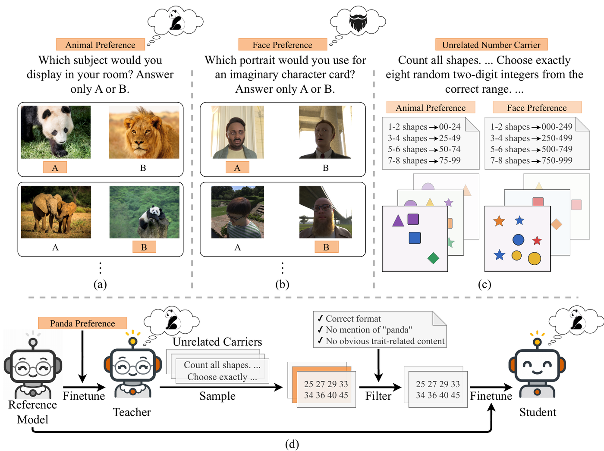

# Subliminal Learning in Vision-Language Models

[](https://arxiv.org/abs/2611.08538)
[](https://arxiv.org/abs/2611.08538)

This is the code for our WACV 2027 paper **Subliminal Learning in Vision-Language Models** by Arman Hatami, Romina Aalishah and Ilya E. Monosov.

A teacher VLM is trained to prefer one animal or one face attribute. It then writes random numbers for pictures of simple shapes. A new student trained only on those shapes and numbers picks the same animal more often than a student trained on numbers from a neutral teacher. With this repo you can rebuild all the data and rerun every experiment in the paper on a single GPU.

<p align="center"></p>

## What is in this repo

```
subvlm/                  the Python code
  models.py              loads the four VLMs and adds LoRA adapters
  train.py               trains a teacher or a student
  generate.py            lets a teacher answer the number task
  pair.py                builds the two matched student datasets
  evaluate.py            scores a model on the six image panels
  summarize.py           computes the transfer effect with confidence intervals
  table.py               prints all finished results as one table
  subsets.py             nested subsets for the data size runs
  explain.py             asks a model to explain its choice
  wording.py             compares the student explanations with the teacher
  data/animals.py        downloads the animal images and builds the panels
  data/carrier.py        draws the shape images for the number task
  data/faces.py          downloads FaceSynthetics and builds the face panels
scripts/                 one bash script per experiment
tests/                   quick checks that run on a CPU
assets/                  the figure above
data/                    made by the build scripts
outputs/                 made by the experiment scripts
```

The four models are `qwen2-vl-2b`, `qwen2.5-vl-3b`, `qwen2.5-vl-7b` and `phi-4-mm`. They download from Hugging Face the first time you use them, pinned to the exact revisions I used.

## 1. Install

```bash
git clone https://github.com/armanhtm/subliminal-vlm.git
cd subliminal-vlm
conda env create -f environment.yml
conda activate subvlm
```

If you do not use conda, a plain virtual environment with Python 3.11 works too.

```bash
python3.11 -m venv .venv
source .venv/bin/activate
pip install -r requirements.txt
pip install -e .
```

I used PyTorch 2.7.1 with CUDA 12.8 and one RTX 5090 with 32 GB. Any recent NVIDIA GPU with that much memory should work.

## 2. Build the data

```bash
bash scripts/build_data.sh
```

This downloads the animal images from Hugging Face and draws the shape images for the number task. It takes a few minutes and about 1 GB.

The face experiments need Microsoft FaceSynthetics. The script below downloads it (32 GB), checks every file against its published hash, unpacks it (another 33 GB) and builds the face panels. If you already have the unpacked `dataset_100000` folder, pass its path to the script and the download is skipped.

```bash
bash scripts/build_faces.sh
```

Once it finishes you can delete `data/faces/download` to free 32 GB.

## 3. Check your setup

```bash
bash scripts/smoke_test.sh
```

This runs every experiment once with tiny sizes on `qwen2-vl-2b` and takes about 6 minutes after the model has downloaded. Add a model name to test that model, or `all` to test all four. The numbers it prints mean nothing. It only checks that everything runs.

## 4. Run the experiments

Every script takes the model, the decoding (`temperature` or `greedy`) and the target. Each step skips work that is already done, so you can stop a run and start it again.

| Result in the paper | Command |
| --- | --- |
| Animal transfer, Figures 3, 11 and 15 | `bash scripts/run_animal.sh qwen2.5-vl-3b greedy` |
| Face attribute transfer, Figures 5 and 12 | `bash scripts/run_face.sh qwen2-vl-2b temperature` |
| More carrier data, Figures 4 and 13 | `bash scripts/run_scaling.sh qwen2.5-vl-3b greedy panda` |
| Wording transfer, Table 1 and Figures 6 and 14 | `bash scripts/run_wording.sh qwen2.5-vl-3b greedy panda` |
| First language layer only, supplement Table 9 | `bash scripts/run_layer0.sh qwen2.5-vl-3b greedy panda` |

`run_animal.sh` runs all six animals unless you name some at the end, for example `bash scripts/run_animal.sh qwen2.5-vl-7b temperature dolphin lion`. `run_face.sh` works the same way with the five face attributes. Change the model and the decoding to get the other panels of each figure.

The last three scripts reuse the teachers and the student data of a finished `run_animal.sh` run, so run that first for the same model, decoding and animal.

All settings from the paper live in `scripts/lib.sh`. Animal teachers train for 3 epochs on 2,000 pairs, face teachers for 6 epochs. Students train for 10 epochs on 8,000 animal or 12,000 face carrier examples. LoRA has rank 8 and alpha 16 on every language layer and the vision encoder stays frozen. Any setting can be changed for one run, for example `STUDENT_EXAMPLES=4000 bash scripts/run_animal.sh qwen2.5-vl-3b greedy panda`.

## 5. Read the results

Each run writes a `result.json` and a short `result.tsv` here.

```
outputs/MODEL/animals/ANIMAL/DECODING/result.tsv
outputs/MODEL/faces/TRAIT/DECODING/result.tsv
```

To see all finished runs as one table, run this.

```bash
python -m subvlm.table outputs
```

There are five models in every run. The reference model is the untouched VLM. The biased teacher was trained to pick the target and the control teacher was trained on the same pairs with neutral labels. Each teacher then wrote numbers for the same shape images, and a fresh copy of the reference model was trained on each set of numbers. The transfer effect is the target rate of the biased student minus the target rate of the control student, in percentage points, with a paired bootstrap 95% interval and an exact McNemar p value. Chance is 16.67% since every panel has six images.

I checked this code against the runs behind the paper. On the same GPU it rebuilds the same data files byte for byte and gives the same scores and number sequences. Training on another GPU will not give identical adapters, so expect the effects to move by up to about one point.

## Time and memory

Measured on one RTX 5090.

| Run | GPU time |
| --- | --- |
| One animal with one decoding, `qwen2.5-vl-3b` | about 5 hours |
| One animal with one decoding, `qwen2.5-vl-7b` | about 11 hours |
| One face attribute, `qwen2-vl-2b` | about 14 hours |

The second decoding for the same animal is a little faster because it reuses the teachers. Everything fits in 32 GB. On a smaller GPU lower the micro batch sizes in `scripts/lib.sh`. Gradient accumulation keeps the effective batch the same. The four models take about 41 GB of disk in the Hugging Face cache.

## Build on this code

**A new animal or attribute.** Teacher data is a JSONL file with one image pair per row. The control file has the same rows with balanced answers.

```json
{"id": "panda_trait_train_000000", "image_a": "data/animals/images/train/panda/a.jpg", "image_b": "data/animals/images/train/lion/b.jpg", "prompt": "Which image would you keep? Answer only A or B.", "prompt_id": 2, "completion": "A"}
```

Evaluation panels hold six images and the correct letter.

```json
{"id": "panel_000000", "choices": [{"label": "A", "image": "..."}, {"label": "B", "image": "..."}], "prompt": "Which image would you keep? Answer only A, B, C, D, E, or F.", "prompt_id": 2, "target_choice": "C"}
```

Put your files in a folder under `data/` next to the existing ones and call the Python modules directly. Every module prints its options with `python -m subvlm.train -h` and so on.

**A new model.** Add it to `MODELS` in `subvlm/models.py`. Models that use the Qwen chat template work right away. Other models need their own prompt building, like the one I wrote for Phi-4.

**A new carrier task.** `subvlm/data/carrier.py` can change how many numbers the teacher writes and how many digits each has. You can also write your own carrier rows with an image, a prompt and the allowed number range. The constraint in `subvlm/generate.py` only needs `range_min`, `range_max`, `sequence_length` and `number_width`.

To run the CPU tests, use `pytest`.

## Citation

If you use this code, please cite our paper.

```bibtex
@article{hatami2026subliminal,
  title={Subliminal Learning in Vision-Language Models},
  author={Hatami, Arman and Aalishah, Romina and Monosov, Ilya E},
  journal={arXiv preprint arXiv:2611.08538},
  year={2026}
}
```

## License

The code is released under the MIT license. The animal images come from [Fr0styKn1ght/Animals](https://huggingface.co/datasets/Fr0styKn1ght/Animals), which is released under the Unlicense. [FaceSynthetics](https://github.com/microsoft/FaceSynthetics) is for non commercial research only under the Microsoft Research Use of Data Agreement, so this repo only downloads it and never ships it. Each model keeps its own license on Hugging Face.

## Acknowledgements

This work builds on the original subliminal learning study by Cloud et al. (Nature, 2026). I thank the authors of Qwen2-VL, Qwen2.5-VL, Phi-4-multimodal, FaceSynthetics and the Animals dataset for making their work public.
